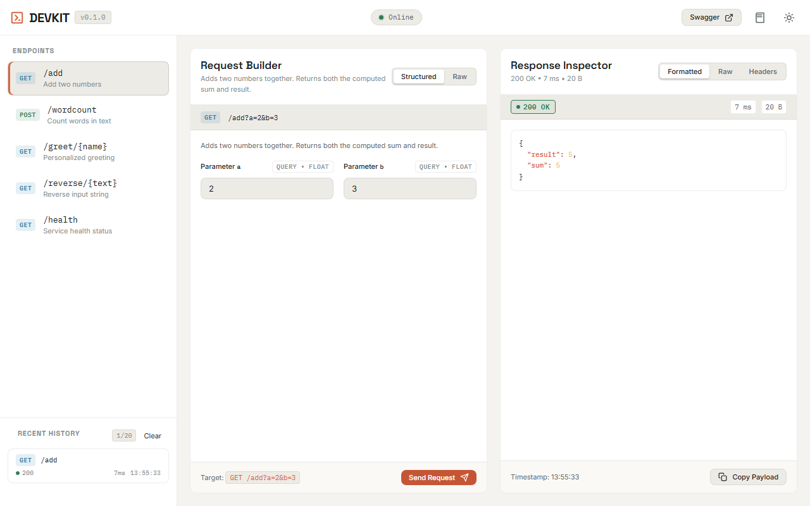
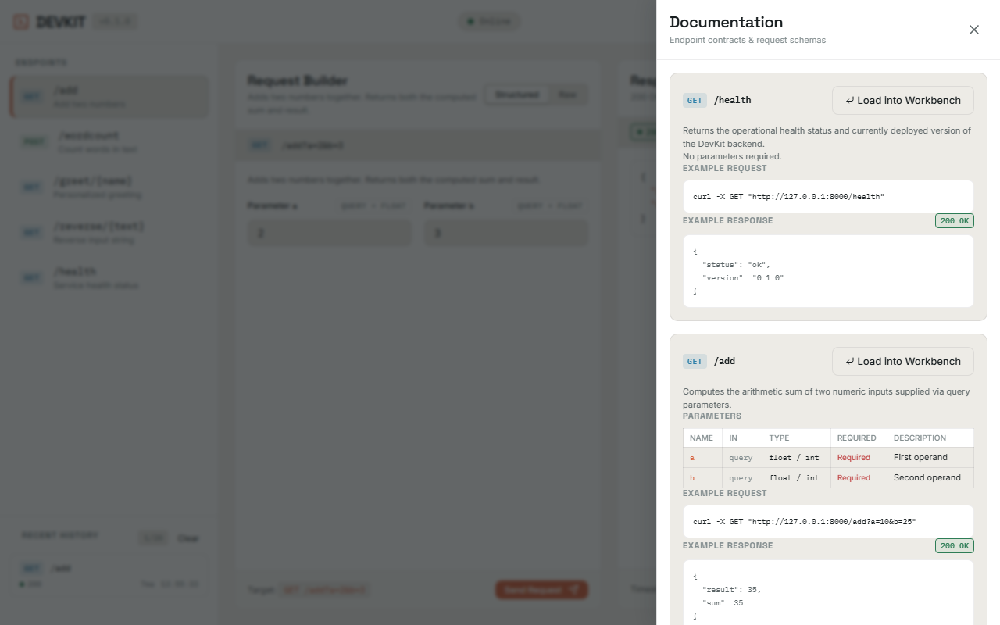
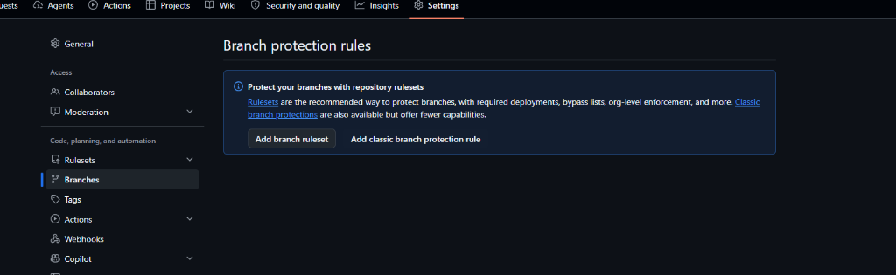
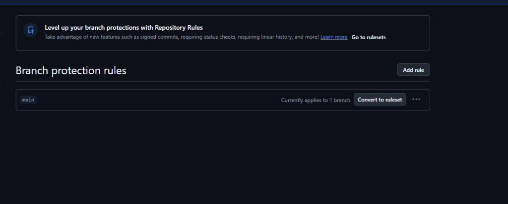
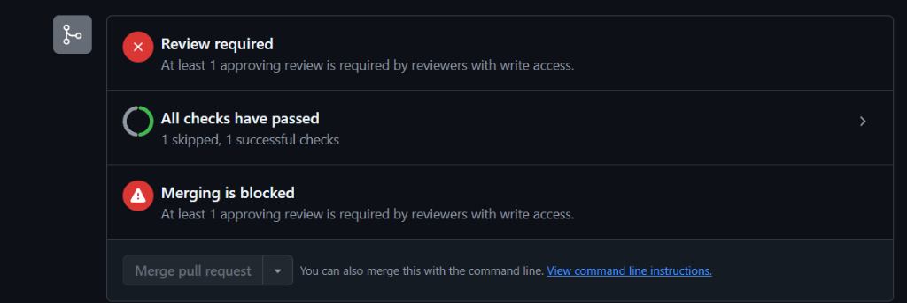
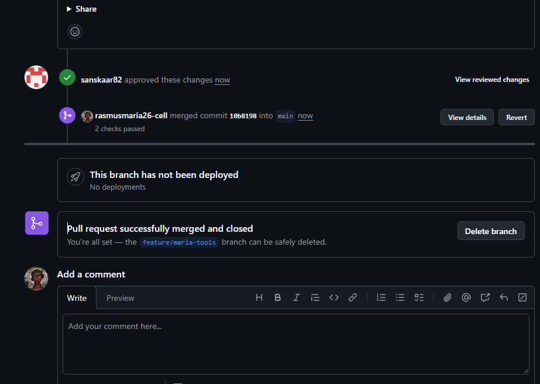
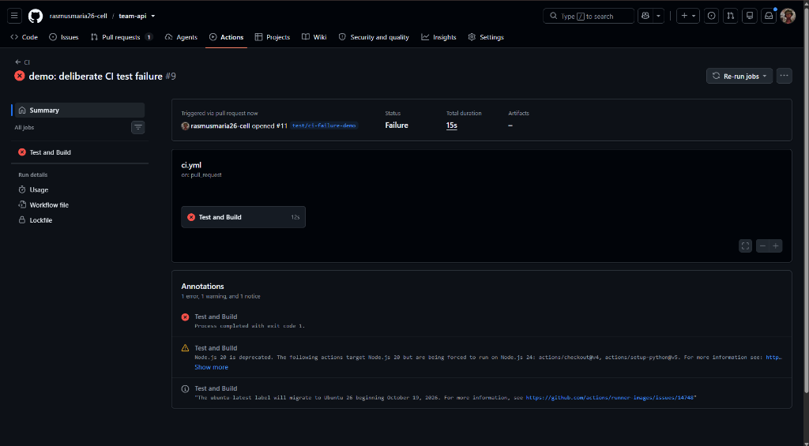
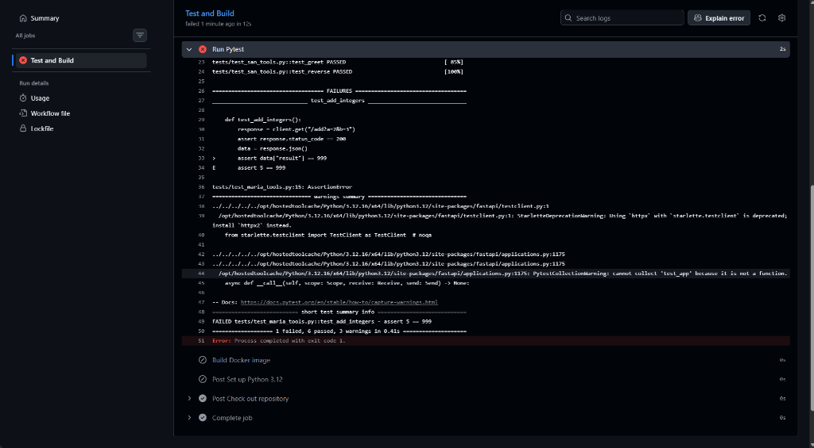
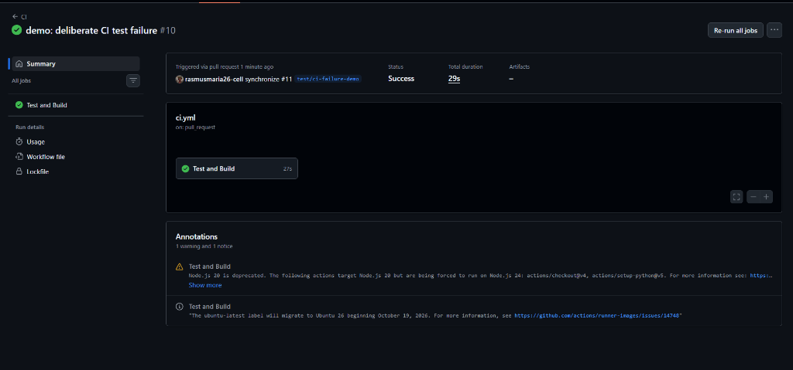

# DevKit API & Workbench — Team 5

[](https://github.com/rasmusmaria26-cell/team-api/actions/workflows/ci.yml)


A precision developer utility toolkit API built with **FastAPI**, containerized with **Docker**, automated with **GitHub Actions CI/CD**, deployed to **Railway**, and delivered with a built-in, zero-build interactive **API Workbench**.

---

## 1. Project Overview

DevKit API provides lightweight, high-performance developer utilities accessible via standard REST endpoints and an integrated browser workbench. The project was engineered collaboratively following strict dual-developer ownership, continuous integration, branch protection, and containerized deployment.

### Key Capabilities
- **FastAPI Backend Services:** Strict type validation, auto-generated OpenAPI schemas, and sub-millisecond JSON/string execution.
- **Embedded DevKit Workbench:** Zero-build, same-origin developer workbench mounted directly at `/` (no Node build step, bundlers, or external CDNs required).
- **Automated CI/CD:** GitHub Actions workflows running automated test suites, Docker image builds, Railway deployments, and live smoke testing.
- **Branch Protection & Governance:** Enforced peer review and automated status checks on `main` to prevent unreviewed changes.

---

## 2. Interactive DevKit Workbench

DevKit features a built-in developer workbench accessible directly at `http://127.0.0.1:8000/`. It serves as an in-browser workspace for configuring requests, inspecting responses, testing edge cases, and reading endpoint specifications.



### Workbench Features
1. **Request Builder (Structured & Raw Modes):**
   - **Structured Mode:** Tailored parameter forms for all endpoints (`/add`, `/wordcount`, `/greet`, `/reverse`, `/health`) with real-time numeric and whitespace validation.
   - **Raw Mode:** Direct JSON editing with live JSON validation and character counters.
   - **Target URL Preview:** Dynamic relative URL construction reflecting query parameters and URL-encoded path variables in real time.
2. **Response Inspector:**
   - **Formatted JSON View:** High-performance, HTML-escaped syntax highlighting for keys, strings, numbers, booleans, and nulls.
   - **Raw & Headers Views:** Complete access to raw HTTP payload bytes and response header key-value tables.
   - **Live Telemetry:** Exact HTTP status badge, round-trip execution duration in milliseconds, and calculated payload size.
   - **Clipboard Action:** One-click payload copying with visual confirmation.
   - **In-Flight Retention:** Retains existing responses with an in-flight dimming badge while new requests execute.
3. **Request History:**
   - 20-item FIFO local storage queue.
   - One-click recall: clicking any historical item repopulates the Request Builder, parameters, and URL target bar.
   - **Privacy Guard:** Never persists response bodies, credentials, or sensitive headers to local storage.
4. **Interactive Documentation Drawer:**
   - Slide-out drawer with complete schemas, parameter definitions, request curl examples, and response schemas.
   - **"Load into Workbench":** One-click button that populates default sample values into the builder and closes the drawer.
5. **Ergonomics & Accessibility:**
   - **Theme Switching:** Dark and Light themes with automatic OS preference detection (`prefers-color-scheme`).
   - **Connection Health Polling:** Background `/health` polling every 15 seconds displaying a real-time `Online` / `Degraded` status pill.
   - **Keyboard Shortcuts:** Global `Ctrl + Enter` (or `Cmd + Enter`) executes the active request.
   - **Full WCAG Accessibility:** Accessible focus trapping, Escape key dismissal, and visible focus rings throughout.



---

## 3. API Endpoints & Specifications

The backend exposes five core developer endpoints:

| Method | Endpoint | Parameters / Body | Response Schema | Description |
|---|---|---|---|---|
| `GET` | `/health` | None | `{"status":"ok","version":"<str>"}` | Operational status & deployed version |
| `GET` | `/add` | Query: `a` (float), `b` (float) | `{"result":<float>,"sum":<float>}` | Sum of two numbers |
| `POST` | `/wordcount` | Body: `{"text":"<str>"}` | `{"word_count":<int>,"count":<int>}` | Total word count of text |
| `GET` | `/greet/{name}` | Path: `name` (str) | `"Hello, {name}!"` | Personalized greeting message |
| `GET` | `/reverse/{text}` | Path: `text` (str) | `"{reversed_text}"` | Reversed string output |

### Sample Requests & Responses

#### Health Check
```bash
curl -X GET "http://127.0.0.1:8000/health"
# Response:
# {"status":"ok","version":"0.1.0"}
```

#### Add Two Numbers
```bash
curl -X GET "http://127.0.0.1:8000/add?a=10.5&b=4.5"
# Response:
# {"result":15.0,"sum":15.0}
```

#### Word Count
```bash
curl -X POST "http://127.0.0.1:8000/wordcount" \
  -H "Content-Type: application/json" \
  -d '{"text": "DevKit makes API testing fast and precise."}'
# Response:
# {"word_count":7,"count":7}
```

#### Personalized Greeting
```bash
curl -X GET "http://127.0.0.1:8000/greet/Engineer"
# Response:
# "Hello, Engineer!"
```

#### Reverse String
```bash
curl -X GET "http://127.0.0.1:8000/reverse/workbench"
# Response:
# "hcknebrow"
```

Interactive OpenAPI Swagger UI is available at `/docs` and the raw schema at `/openapi.json`.

---

## 4. Repository Structure

```text
team-api/
├── app/
│   ├── __init__.py
│   ├── main.py                  # FastAPI app, /health, router registration & static mounting
│   ├── version.txt              # Application version tracking
│   ├── routers/
│   │   ├── __init__.py
│   │   ├── maria_tools.py       # /add and /wordcount endpoints
│   │   └── san_tools.py         # /greet and /reverse endpoints
│   └── static/                  # Built-in zero-build DevKit Workbench
│       ├── index.html           # Workbench application shell & layout
│       ├── css/
│       │   └── style.css        # Design tokens, CSS grid, dark/light themes
│       └── js/
│           ├── app.js           # Main controller, history, overlays & shortcuts
│           ├── api.js           # ApiClient service, latency & error handling
│           ├── history.js       # 20-item FIFO localStorage repository
│           └── docs.js          # Interactive documentation schemas & renderer
├── tests/
│   ├── __init__.py
│   ├── test_health.py           # Health check and version tests
│   ├── test_maria_tools.py      # /add and /wordcount unit tests
│   ├── test_san_tools.py        # /greet and /reverse unit tests
│   └── test_ui.py               # Workbench root, static assets & integration tests
├── docs/
│   └── images/                  # Documentation screenshots & evidence
├── .github/
│   └── workflows/
│       ├── ci.yml               # GitHub Actions CI (tests + Docker build)
│       └── deploy.yml           # GitHub Actions CD (Railway deploy + smoke test)
├── Dockerfile                   # Production Python 3.12-slim image
├── .dockerignore
├── requirements.txt             # Production runtime dependencies
├── requirements-dev.txt         # Testing and development dependencies
├── TEAM_WORK_ALLOCATION.md      # Strict task allocation, branch matrix & logs
└── README.md                    # Project documentation
```

---

## 5. Local Setup & Development

### Prerequisites
- Python 3.12 or newer
- Git
- Docker (optional, for container runs)

### Installation
1. **Clone the repository:**
   ```bash
   git clone https://github.com/rasmusmaria26-cell/team-api.git
   cd team-api
   ```

2. **Create and activate a virtual environment:**
   ```bash
   python -m venv venv
   # On macOS/Linux:
   source venv/bin/activate
   # On Windows:
   .\venv\Scripts\activate
   ```

3. **Install dependencies:**
   ```bash
   pip install -r requirements.txt -r requirements-dev.txt
   ```

4. **Start the local server:**
   ```bash
   uvicorn app.main:app --reload --host 127.0.0.1 --port 8000
   ```

5. Open [http://127.0.0.1:8000/](http://127.0.0.1:8000/) to access the DevKit Workbench, or [http://127.0.0.1:8000/docs](http://127.0.0.1:8000/docs) for Swagger UI.

---

## 6. Automated Testing & Verification

The repository includes a comprehensive 13-test automated test suite covering all backend endpoints, error handling, static asset delivery, and routing precedence.

Run the test suite with Pytest:
```bash
python -m pytest -v
```

Expected output:
```text
tests/test_health.py::test_health_check_returns_ok_and_version PASSED    [  7%]
tests/test_maria_tools.py::test_add_integers PASSED                     [ 15%]
tests/test_maria_tools.py::test_add_floats PASSED                       [ 23%]
tests/test_maria_tools.py::test_wordcount_standard PASSED               [ 30%]
tests/test_maria_tools.py::test_wordcount_empty PASSED                  [ 38%]
tests/test_san_tools.py::test_greet PASSED                              [ 46%]
tests/test_san_tools.py::test_reverse PASSED                            [ 53%]
tests/test_ui.py::test_ui_root_serves_workbench_html PASSED             [ 61%]
tests/test_ui.py::test_ui_index_html_direct_route PASSED                [ 69%]
tests/test_ui.py::test_ui_css_stylesheet_served PASSED                  [ 76%]
tests/test_ui.py::test_ui_javascript_modules_served PASSED              [ 84%]
tests/test_ui.py::test_api_routes_precedence_over_static PASSED         [ 92%]
tests/test_ui.py::test_openapi_and_docs_remain_available PASSED         [100%]

======================= 13 passed in 0.67s =======================
```

Validate JavaScript ES modules syntax:
```bash
node --check app/static/js/app.js
node --check app/static/js/api.js
node --check app/static/js/history.js
node --check app/static/js/docs.js
```

---

## 7. Docker Containerization

The service is packaged using a slim, multi-environment Docker container.

### Build and Run Docker Image
```bash
# Build the Docker image
docker build -t team-api .

# Run container on port 8000
docker run -p 8000:8000 team-api
```

The Docker container listens on `0.0.0.0` and dynamically binds to the `$PORT` environment variable provided by container orchestrators such as Railway.

---

## 8. Branch Protection & Review Workflow

To enforce code quality, stability, and peer review standards, the repository's `main` branch is protected by GitHub branch protection rulesets:
1. **Require Pull Requests before merging:** Direct commits and force-pushes to `main` are strictly prohibited.
2. **Require Approvals:** At least 1 approving review from a peer collaborator with write access is mandatory.
3. **Require Status Checks to Pass:** The `Test and Build` CI job must pass before merge eligibility.

### Configuration & Active Ruleset
Branch protection was configured under **Settings → Branches → Branch protection rules**:



Active rule enforcing protection across the `main` branch:



### Enforced Peer Review in Practice
When a developer opens a pull request, merging is blocked until an approving review is submitted by a peer:



Once approved and all CI checks pass, the PR is merged into `main`:



---

## 9. Deliberate CI Failure Demonstration (Phase 10)

As part of workshop quality verification, the team demonstrated CI effectiveness by deliberately introducing a broken test assertion on a dedicated branch (`test/ci-failure-demo`):

### 1. Deliberate Failure Triggered
In `tests/test_maria_tools.py`, the assertion was intentionally altered to `assert data["result"] == 999` (expected `5`).

The pull request CI run failed immediately within 15 seconds, blocking merge:



### 2. Failure Annotation in Logs
GitHub Actions captured the assertion failure in Pytest and flagged the failure annotation:



### 3. Restoration and Green Build
The assertion was restored to `assert data["result"] == 5`. CI immediately passed on run #10 (29s), unblocking the pull request for peer approval and merge:



---

## 10. Team Work Allocation & History

Task ownership and file boundaries were established before implementation to prevent conflicts:

| Member | Role | Key Responsibilities |
|---|---|---|
| **Maria Rasmus** (@rasmusmaria26-cell) | Project & CI/CD Lead | Local repo skeleton, CI workflow, branch protection, Railway setup & deploy workflow, `/add`, `/wordcount`, documentation |
| **Sanskaar Singh** (@sanskaar82) | Backend & Docker Lead | FastAPI starter application, version handling, Dockerfile & containerization, `/greet`, `/reverse`, router integration |

### Pull Request History
All 12 phases were delivered via isolated pull requests reviewed by the other team member:
- **PR #1:** `setup/starter` — FastAPI starter, health endpoint & version handling
- **PR #2:** `setup/tests` — Health check test suite & dev requirements
- **PR #3:** `setup/docker` — Dockerfile and `.dockerignore`
- **PR #4:** `setup/ci` — GitHub Actions CI workflow
- **PR #5:** `setup/deploy` — Railway deployment workflow and smoke test
- **PR #6:** `feature/maria-tools` — `/add` and `/wordcount` feature endpoints
- **PR #7:** `feature/san-tools` — `/greet` and `/reverse` feature endpoints
- **PR #8:** `integration/register-routers` — Feature router registration in `app/main.py`
- **PR #9 & #10:** Merge conflict resolution demonstration
- **PR #11:** `test/ci-failure-demo` — Deliberate CI failure & restoration demonstration
- **PR #12:** `docs/complete-handover` — Final task tracking and phase log
